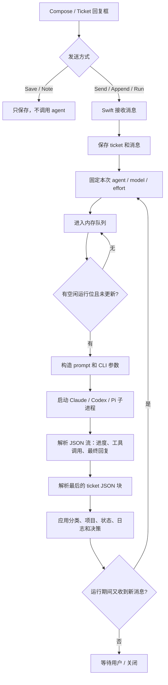
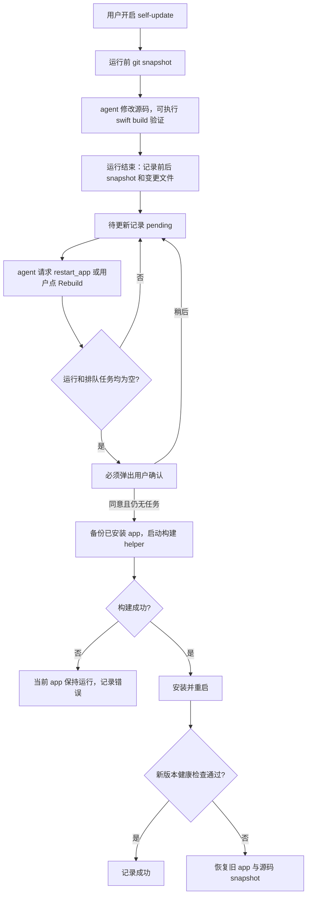

# Ticket 系统：工作流与代码架构

本文对应 ticket #16 的源码修改；需用户确认更新后才在已安装应用中生效。

## 从输入到回复

Send 默认由 autoProcess 控制是否启动；Append 一定启动 agent；Save 不启动。
普通回复同样受 autoProcess 控制，Run agent 显式启动。Note 保存文字并保持原状态。

默认配置只用于未指定的字段；手动选择优先。入队时固定该选择，之后改 Settings
不会改变已排队任务。正在运行时发的新消息不切换当前进程，而是在当前轮完成后
用新选择启动下一轮；多条未处理消息合并到下一轮，最后一次明确发送的选择生效。
下一次独立发送若未指定选项，仍使用全局默认。

## 状态不是队列

- `unprocessed`：新建，尚未分类。
- `needs_agent`：需要 agent 处理。
- `waiting_human`：等待人回复或下一步。
- `closed`：结束。

运行中、排队中是额外的运行时信息，不是 ticket 状态。失败或停止会追加系统说明，
可手动 Run agent 重试。没有合法 ticket 块时，只保存回复，默认等待用户。

## 并行与排队

- 关闭 self-update：最多 2 个 ticket 同时运行，先进先出。
- 开启 self-update：最多 1 个，因为每轮都可能编辑同一份应用源码。
- 同一个 ticket 不会同时启动两个进程。运行中新增的回复保留给下一轮。
- snapshot 收尾、构建期间暂停出队；正常结束后继续。
- CLI 各自内部是否使用子 agent，由 CLI 自己控制；这和 app 的 ticket 并发不同。

当前没有按项目或工作目录加锁，也没有独立 worktree。即使普通模式可并行，两个
agent 写同一项目仍可能冲突。要安全地让自更新和其他 ticket 并行，需要先隔离写入
目录、定义锁和提交合并流程；本次没有扩大并发。

## 自更新：准备和安装分开

确认是安装重启的必经步骤，旧配置 `self_update_confirm: false` 也不能跳过。
点击重建时只要还有运行或排队的 ticket 就拒绝执行，记录保持 pending，待任务完成后
手动重试。弹窗期间收到新任务也取消本次安装并恢复队列，不会停止 agent 来腾出位置。
回滚源码也必须等待队列和运行任务清空，并先确认。

开启 self-update 是允许 agent 准备源码修改；每次安装重启仍需单独同意。
构建的是当时整份工作目录，确认涉及的文件数是该轮记录，不能保证只包含该轮修改。
快照会包含原有未提交文件，因此人工编辑与 agent 编辑目前不能自动区分。

## 代码架构与运行组件

这里是本机软件架构；系统没有专门的硬件设计。macOS app 负责 UI、文件和调度，
本机 CLI 子进程访问模型服务；模型请求在 CLI 内部执行。无需额外服务器或数据库。

| 层 | 文件 | 职责 |
|---|---|---|
| 界面 | `Resources/tickets/compose.js`、`app.js`、`logic.js`、`canvas.js`（设计画布） | 输入、选模型、视图、向 Swift 发消息 |
| WebView 桥 | `TicketWindows.swift` | WKWebView、本地资源与消息桥 |
| 控制器 | `TicketsPlugin.swift` | 设置、路由消息、保存输入、调度 agent、广播状态 |
| 数据 | `TicketModel.swift`、`TicketStore.swift`、`TicketMarkdown.swift` | 模型、文件读写、合并、状态与决策日志 |
| 调度与协议 | `TicketAgent.swift` | 选择优先级、队列、CLI 参数、prompt、流解析、应用 ticket 块 |
| 自更新 | `TicketSelfUpdate.swift`、`TicketGit.swift` | 快照、确认、构建、备份、健康检查、回滚 |
| 运行基础 | `Core/Shell.swift` | 环境、进程、流式输出 |
| 项目导入 | `TicketWorkspaceImport.swift` | 导入 CONTEXT / PLAN 为项目上下文和计划 |

持久化目录：`tickets/*.md`、`attachments/`、`structure.json`、`tags/`（分层标签词表，见 `TicketTags.swift`）、`designs/*.canvas`、`agent/`、`self-update/`。
Agent 的工具（`create_ticket`、`update_ticket`、`define_tag`、`save_design` 等）定义并执行于 `TicketTools.swift`。
队列顺序在内存中；待运行的 picker 选择另存于 `agent/queued-choices.json`。
开启 autoProcess 时，重启后扫描满足条件的待处理 ticket 并恢复其选择，队列顺序可能不同。
关闭 autoProcess 时仍需手动 Run；运行中的进程和工具进度不能在崩溃后原地续跑。
构建期间新送达的 ticket 会先保存并排队，在更新完成后处理。

## #16 确认的问题与验证边界

1. Compose 成功 toast 原来总用 Settings 的默认 agent；实际 enqueue 已传用户选择。
   因此“Codex 接手”本身不能证明实际启动了 Codex；最终回复旁的 agent/model 标签才记录实际选择。
2. enqueue 原来在检查 busy 时直接返回，运行中追加回复的选择因此丢失；现保留到下一轮。
3. 未选字段原来在开始运行时才读默认值；现发送入队时固定。
4. 自更新原来允许跳过确认，手动 rebuild 还会 stopAll；现集中确认且要求队列空闲。

验证：`tests/tickets_dispatch.test.cjs` 执行真实选择和队列方法，隔离 app/CLI 边界，
覆盖选择优先级、排队默认值、运行中续问、替换排队选择、停止、两路并发、自更新串行、暂停恢复和重启恢复待运行模型选择。
`scripts/tickets-test.sh` 检查格式、快照、网页逻辑和项目导入。`swift build` 检查整体编译。
这些检查不会调用付费模型，也不安装或重启 app。真实菜单选择、确认弹窗及升级回滚
仍需安装后人工验收；本次不冒充已完成这些端到端验证。
